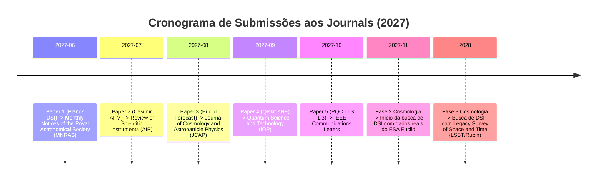

# 🌌 Scientific Research Roadmap: 2027--2028
**Autor:** Bruno L. Olivaes  
**Afiliação:** Pesquisador Independente, Brasil  

Este documento traça o cronograma de submissões em periódicos internacionais indexados (peer-reviewed) para os 5 manuscritos pioneiros, além do planejamento científico para a chegada dos dados observacionais de próxima geração.

---

## 📅 Cronograma de Submissões em Periódicos (Peer Review)

### 1. Junho de 2027: Paper 1 no MNRAS
- **Título:** *Constraints on Primordial Discrete Scale Invariance from the Planck 2018 Temperature Power Spectrum*
- **Periódico Alvo:** *Monthly Notices of the Royal Astronomical Society* (MNRAS, Oxford University Press)
- **Fator de Impacto:** $\sim 4.8$
- **Destaque:** Apresentação do resultado nulo pré-registrado com 5 portas de integridade metodológica e limite superior de $95\%$ CL em $\epsilon < 0.05$.

### 2. Julho de 2027: Paper 2 no Review of Scientific Instruments
- **Título:** *Artifact-Resistant Spectral Analysis in Dynamic AFM Casimir Force Measurements*
- **Periódico Alvo:** *Review of Scientific Instruments* (RSI, American Institute of Physics)
- **Fator de Impacto:** $\sim 1.6$
- **Destaque:** Demonstração dos efeitos espúrios de borda (Runge ringing) em dados de AFM de Casimir e isolamento de potenciais de contato via regularização spline penalizada.

### 3. Agosto de 2027: Paper 3 no JCAP
- **Título:** *Forecasting Log-Oscillatory Dark Energy with ESA Euclid: Breaking the Degeneracy*
- **Periódico Alvo:** *Journal of Cosmology and Astroparticle Physics* (JCAP, IOP / SISSA)
- **Fator de Impacto:** $\sim 6.4$
- **Destaque:** Matriz de covariância completa do Pantheon+, combinação com DESI 2024 e Planck, e quebra de degenerescência a $>3\sigma$ em $z=3$ pela espectroscopia do telescópio espacial Euclid.

### 4. Setembro de 2027: Paper 4 no Quantum Science and Technology
- **Título:** *When Harmonic ZNE Fails: A Comparative Benchmark of Error Mitigation on NISQ Devices*
- **Periódico Alvo:** *Quantum Science and Technology* (QST, IOP Publishing)
- **Fator de Impacto:** $\sim 6.7$
- **Destaque:** Benchmark pré-registrado provando a superioridade do Clifford Pauli Twirling ($81\%$ de mitigação) sobre modelos harmônicos em circuitos multi-qubit acoplados.

### 5. Outubro de 2027: Paper 5 no IEEE Communications Letters
- **Título:** *The Network Cost of Post-Quantum Cryptography: TCP Fragmentation in TLS 1.3 Handshakes*
- **Periódico Alvo:** *IEEE Communications Letters* / *Computer Networks* (Elsevier)
- **Fator de Impacto:** $\sim 4.3$
- **Destaque:** Demonstração empírica de que o ML-KEM-768 é $740\times$ mais rápido que o RSA-2048, mapeando o limiar de fragmentação TCP sobre MSS de $1.460\,$bytes e a conformidade com a RFC 6928 (`initcwnd = 10`).

---

## 🔭 Próximas Frentes Observacionais (2027--2028)

### 6. Novembro de 2027: Ingestão de Dados Públicos do ESA Euclid
- Aplicação do pipeline [`dsi-cosmo-search`](https://github.com/bruno-olivaes/dsi-cosmo-search) diretamente sobre o espectro de potência angular de galáxias e clustering do Euclid Data Release 1 (Q1/Q2 2027), estendendo o teste de Invariância de Escala Discreta até $z \sim 2.0$.

### 7. 2028: Vera C. Rubin Observatory (LSST)
- Utilização dos dados fotométricos de 10 anos do Legacy Survey of Space and Time (LSST) para investigar modulações oscilatórias em aglomerados de galáxias e lentes gravitacionais fracas (cosmic shear).
